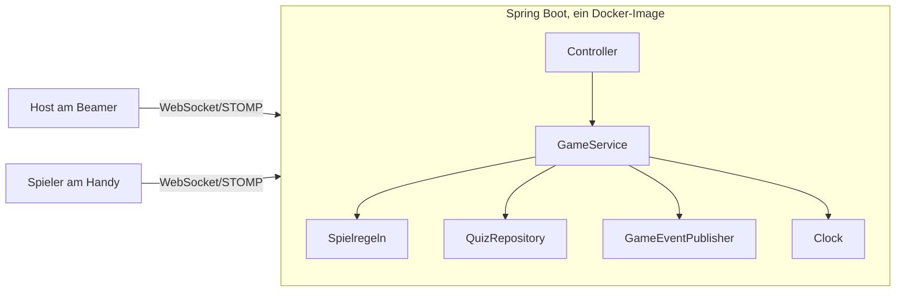

# Projektplan Yahoot

Yahoot ist ein Live-Quiz wie Kahoot: Der Host zeigt die Fragen auf dem Beamer, alle anderen spielen
auf dem Handy. Der Unterschied ist die **Sabotage**. Wer richtig antwortet, sammelt Energie und kann
damit den Bildschirm von Mitspielern angreifen.

## Spielregeln

Eine Runde läuft so ab: Frage → Antworten → Auflösung und Rangliste → 10 Sekunden Sabotage-Phase.

| Regel | Wert |
|---|---|
| Punkte | nur für richtige Antworten, je schneller desto mehr |
| Energie | Start 1, +1 pro richtige Antwort |
| Comeback | das hinterste Drittel der Rangliste bekommt +1 Energie extra, ab zwei Spielern mindestens einer; Punktgleiche an der Grenze zählen mit, bei Gleichstand aller niemand |
| Limit | pro Spieler eine Karte pro Sabotage-Phase |
| Namen | 1 bis 20 Zeichen, Leerzeichen am Rand fallen weg, Gross-/Kleinschreibung zählt nicht |

| Karte | Kosten | Wirkung bei der nächsten Frage |
|---|---|---|
| Freeze | 1 | das Opfer kann 3 Sekunden lang nicht antworten |
| Shuffle | 1 | die Antwort-Buttons des Opfers springen herum |
| Klau | 2 | antwortet das Opfer richtig, geht ein Teil seiner Punkte an dich |
| Schild | 1 | blockt den nächsten Angriff auf dich |

Der Server entscheidet alles. Das Handy zeigt nur an, sonst liesse sich zum Beispiel ein Freeze
einfach umgehen. Die genauen Werte können sich beim Testen noch ändern.

## Umfang

**Dabei:** Spiel erstellen und per Code oder QR-Code beitreten, Quiz aus JSON-Dateien, Rundenablauf,
die vier Karten, Rangliste, Rejoin nach Verbindungsabbruch.

**Bewusst nicht dabei:** Login, Datenbank, Quiz-Editor, aufwendige Animationen. Spiele liegen nur im
Arbeitsspeicher und sind nach einem Neustart weg. Das reicht für eine Live-Runde und spart Zeit, die
in saubere Tests fliesst.

**Falls Zeit bleibt:** Teams, danach ein geheimer Verräter im Team.

## Architektur

- **Backend:** Die Spielregeln sind reines Java ohne Spring. Quiz-Quelle, Event-Versand und Uhr
  liegen hinter Schnittstellen und lassen sich dadurch mocken.
- **Frontend:** Container holen die Daten über einen Socket-Service und geben sie an Dumb Components
  weiter. Diese kennen nur Inputs und Outputs.
- **Auslieferung:** Spring Boot liefert auch das Angular-Build aus. Damit gibt es nur eine Adresse und
  kein CORS.

## Tests

| Ebene | Werkzeug | Inhalt | Umfang |
|---|---|---|---|
| Unit Backend | JUnit, AssertJ, Mockito | Spielregeln, GameService mit Mocks | 57 (geplant ca. 25) |
| Unit Frontend | Vitest | Dumb Components, Container mit gemocktem Service | 54 (geplant ca. 15) |
| Integration | Spring Boot Test | echter WebSocket-Client gegen den echten Server | 15 (geplant ca. 6–8) |
| End-to-End | Playwright | Host und Handys im Browser | 14 (geplant ca. 12) |

Die Unit-Tests sind deutlich mehr geworden als geplant, weil beim Bauen viele Randfälle dazukamen. Details
stehen im [Testkonzept](testkonzept.md).

TDD setzen wir bei Spielregeln und GameService konsequent um: Erst kommt der rote Test in einen eigenen
Commit, dann die Implementierung. Bei reinem UI-Aufbau ist TDD erlaubt, aber nicht Pflicht.

## Arbeitspakete

Jedes Paket wird ein eigener Pull Request.

| # | Paket | Inhalt | Stand |
|---|---|---|---|
| 1 | Setup | Grundgerüst, Reports, Pipeline | fertig |
| 2 | Spielregeln | Punkte, Energie, Karten, Rundenablauf mit TDD | fertig |
| 3 | Backend live | Spiele und Lobby, WebSocket, Integrationstests | fertig |
| 4 | Frontend Lobby | Socket-Service, Host-Ansicht, Beitreten | fertig |
| 5 | Frontend Spiel | Fragen, Sabotage-Karten, Rangliste | fertig |
| 6 | End-to-End | 12 Playwright-Tests, Rejoin | fertig |
| 7 | Abschluss | Hosting, Testkonzept anpassen, Reflexion, Präsentation | Testkonzept fertig, Reflexion und Präsentation als Entwurf, Hosting offen |

## Scope und Zeit

Offiziell stehen 2 Wochen zur Verfügung, realistisch sind 2–3. Bei Zeitdruck fallen zuerst die
Bonus-Ideen weg, dann der QR-Code. Die Sabotage und alle Testebenen bleiben, weil sie den Kern des
Projekts und die Bewertung ausmachen.

## Noch offen

- Stunden pro Woche sind noch nicht festgelegt, der Abgleich oben ist darum noch grob.
- Wer die Pull Requests reviewt, ist noch nicht geklärt. Gefordert sind mindestens 3 PRs mit aktiven
  Kommentaren.
- Die Anforderungen stammen aus der Projektbeschreibung und der Zusammenfassung im Haupt-README. Die
  Eckdaten im Original müssen noch abgeglichen werden.
- Der Hosting-Anbieter ist noch nicht gewählt. Die Pipeline veröffentlicht vorerst ein Docker-Image.
- Das Spiel lief bisher nur in emulierten Handys in Playwright, noch nicht auf echten Geräten.
- In der [Reflexion](reflexion.md) fehlt noch unsere eigene Sicht, die [Präsentation](praesentation.md) ist nur als
  Ablauf geplant.
