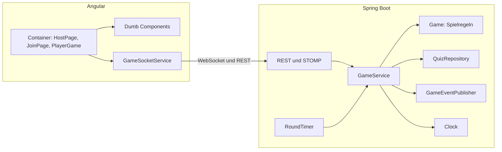

# Testkonzept Yahoot

**Testobjekt:** Yahoot, Live-Quiz mit Sabotage · **Stand:** 02.11.2026

Dieses Konzept ersetzt für das Modulprojekt das vorläufige
[Testkonzept aus Kapitel 6](../../6-testkonzept-vertieft/testkonzept.md), das noch die Student-App als
Platzhalter hatte. Die Struktur nach IEEE 829 bleibt gleich.

## 1 Zusammenfassung

Der Host zeigt die Fragen auf dem Beamer, alle anderen spielen auf dem Handy. Wer richtig antwortet,
sammelt Energie und kann damit Karten gegen Mitspieler einsetzen. Die Regeln sind der riskanteste Teil,
weil viele Fälle zusammenspielen und der Server allein entscheidet. Darum testen wir dort am gründlichsten.
Die Schichten darüber prüfen wir so weit, dass das Zusammenspiel sicher funktioniert.

## 2 Architektur und Test Items

| Test Item | Rolle |
|---|---|
| `Game`, `ScoreCalculator` | Spielregeln als reines Java |
| `GameService`, `RoundTimer` | laufende Spiele, Ereignisse, Zeitsteuerung |
| Controller, `PlayerSessions`, `HostTokens` | Schnittstelle und Rechte |
| Dumb Components, `game-view`, `game-rules` | Anzeige und reine Logik im Frontend |
| Container | verbinden Socket und Anzeige |
| Gesamtsystem als JAR | das, was ausgeliefert wird |

## 3 Was getestet wird

| Ebene | Werkzeug | Inhalt | Anzahl |
|---|---|---|---|
| Unit Backend | JUnit, AssertJ, Mockito | Punkte, Energie, alle Karten, Rundenablauf, Randfälle, GameService, Timer | 57 |
| Unit Frontend | Vitest | Dumb Components, reine Logik, Container mit gefaktem Socket-Service | 54 |
| Integration | Spring Boot Test | echter STOMP-Client gegen den echten Server: Rundenablauf, Rechte, Rejoin, Timer, HTTPS-Proxy | 15 |
| End-to-End | Playwright | ganzes Spiel, alle vier Karten, Lobby, Neuladen, Verbindungsabbruch, zweites Spiel im selben Tab | 14 |

**Gemockt** werden im Backend `QuizRepository`, `GameEventPublisher`, `Clock` und im Timer-Test der
`GameService`, im Frontend der `GameSocketService` und der `GameApiService`. So laufen die Tests schnell und
hängen nicht von echter Zeit oder einem Server ab.

## 4 Was bewusst nicht getestet wird

| Nicht getestet | Begründung |
|---|---|
| Echte Handys und andere Browser | Playwright emuliert ein Pixel 7 in Chromium. Safari auf dem iPhone ist nicht abgedeckt, das prüfen wir von Hand vor der Präsentation |
| Das Spiel im Docker-Image | Playwright testet das JAR. Die Pipeline startet das Image und prüft nur, ob Server, Frontend und Quiz antworten, weil dasselbe JAR darin steckt |
| Last mit vielen Spielern | für eine Runde im Klassenzimmer nicht nötig, kein Lasttest geplant |
| Spring, Angular, STOMP-Bibliotheken | fremder Code |
| Barrierefreiheit | keine Anforderung, nur Grundlagen wie Beschriftungen und Rollen sind umgesetzt |

## 5 Vorgehen

Spielregeln und Backend-Logik entstehen nach **TDD**: zuerst der rote Test in einem eigenen Commit, dann die
Implementierung. Im Frontend gilt das für reine Logik und Komponenten. Reiner Aufbau der Oberfläche darf
auch mit den Tests zusammen entstehen.

Zwei Dinge dazu ehrlich: Um die Commit-Anzahl klein zu halten, fassen wir Rot und Grün pro Thema zusammen.
Die meisten roten Commits scheitern deshalb am Kompilieren, nicht an einer einzelnen Zusicherung. Die
Playwright-Tests sind erst nach der Oberfläche entstanden, sind also kein TDD.

Ob die Tests etwas taugen, haben wir mit einer **Gegenprobe** geprüft: Wir haben absichtlich Fehler eingebaut,
zum Beispiel ein wirkungsloses Freeze oder ein Rejoin ohne Tokenprüfung. Das hat zwei Lücken aufgedeckt, die
beide geschlossen sind:

- Der Playwright-Test fürs Schild blieb auch bei wirkungslosem Schild grün. Er wartete automatisch bis zu 5
  Sekunden, der Freeze dauert aber nur 3. Jetzt prüft er sofort.
- Kein Test prüfte, ob Token und Spieler aus einem anderen Spiel abgelehnt werden. Der Code war richtig, aber
  ungeschützt.

Auch die Gegenprobe selbst kann täuschen: Ein Lauf meldete «gefunden», obwohl Maven wegen eines falschen
Parameters gar keine Tests gestartet hatte. Seither schauen wir bei jedem roten Lauf auf den Grund.

## 6 Kriterien

Ein Test ist bestanden, wenn alle Zusicherungen zutreffen. Bei einem Fehlschlag oder Timeout bleibt die
Pipeline rot, und es wird nichts veröffentlicht. Ein festes Coverage-Gate gibt es nicht. Stand heute: Backend
96,5 % Zeilen und 88,5 % Branches, Frontend 94 % Zeilen und 88 % Branches.

## 7 Testumgebung

| | |
|---|---|
| Laufzeit | Java 21, Node 22 |
| Anwendung | Spring Boot 4.1, Angular 21, Spiele nur im Arbeitsspeicher |
| Reports | Surefire, Failsafe, JaCoCo, Vitest-JUnit und Coverage, Playwright-HTML |
| Pipeline | GitHub Actions, `.github/workflows/yahoot.yml` |

## 8 Planung

| Auslöser | Was läuft |
|---|---|
| Während der Entwicklung | der betroffene Unit-Test |
| Jeder Push und Pull Request | alle Tests, Reports als Artefakte |
| Push auf einen Branch | zusätzlich wird das Docker-Image gebaut und kurz gestartet |
| Push auf `main` | zusätzlich wird das Image veröffentlicht, wenn alles grün ist |
| Vor der Präsentation | ein Spiel von Hand mit echten Handys |
